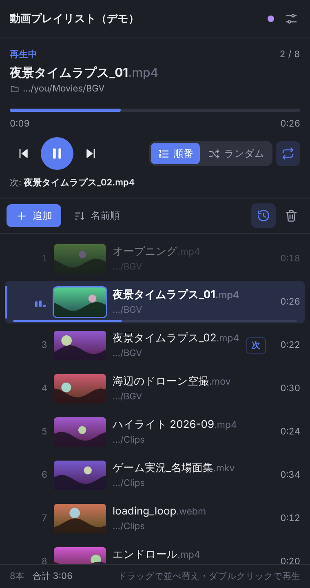

# 動画プレイリスト for OBS

登録した動画を **順番** または **ランダム** で連続再生し続ける OBS 拡張です。
専用ドックで、再生中・これから再生する動画を縦に並べて表示し、**ドラッグで再生順を入れ替え** られます。

- ファイルを1本ずつ追加しても、**フォルダを指定して一括追加** してもOK（サブフォルダも可）
- 順番／ランダム（シャッフル）切替、最後まで行ったら繰り返し（ランダムは再シャッフル）
- 再生中の動画・次の動画・再生済みがひと目でわかる縦リスト（サムネイルと再生時間つき、合計時間も表示）
- 一時停止・シーク・前へ／次へ・今すぐ再生・次に再生・削除
- 開けないファイルは自動でスキップ
- プレイリストはシーンコレクションに保存され、OBS を再起動しても続きから再生

## ダウンロード

[最新の Release](https://github.com/RiTa-23/obs-video-playlist/releases/latest) から **`obs-video-playlist-vX.Y.Z.zip`** をダウンロードして展開してください。
（同じページにある「Source code」ではなく、`obs-video-playlist-` で始まる zip です）

## 中身

| ファイル | 役割 |
| --- | --- |
| `obs-video-playlist.lua` | 再生エンジン。メディアソースに付ける「動画プレイリスト」フィルタを追加します |
| `video-playlist-dock.html` | 操作パネル（ドック）。OBS 内蔵の WebSocket で再生エンジンとやり取りします |

2つは **同じフォルダに置いたまま** 使ってください。

## 必要なもの

- OBS Studio 28 以降（WebSocket サーバー内蔵版）
- Windows / macOS / Linux

追加のインストール（Python など）は不要です。

## 導入（初回だけ）

### 1. スクリプトを読み込む

1. 展開したフォルダを好きな場所に置く（あとで動かすとドックの URL が変わるので、置き場所を決めてから）
2. OBS のメニュー **ツール → スクリプト** を開き、左下の **＋** で `obs-video-playlist.lua` を選ぶ
3. 右側の **「現在のシーンに『動画プレイリスト』を作成」** を押す
   → 画面いっぱいに表示されるメディアソースが作られ、フィルタ画面が開きます

> 既存のメディアソースで使いたいときは、そのソースを右クリック → **フィルタ** → エフェクトフィルタの **＋** → **動画プレイリスト** を追加します。

### 2. WebSocket サーバーを有効にする

1. **ツール → WebSocket サーバー設定** を開く
2. **WebSocketサーバーを有効にする** にチェック
3. **接続情報を表示** で、ポート（通常 4455）とパスワードを控える

### 3. ドックを追加する

1. **ツール → スクリプト** でこのスクリプトを選び、右側の **ドックURL** をコピー
   （`file:///…/video-playlist-dock.html` という形）
2. **ドック → カスタムブラウザドック**（OBS 28〜29 は **表示 → ドック → カスタムブラウザドック**）を開く
3. 名前に「動画プレイリスト」、URL に貼り付けて **適用**
4. ドックが開いたら、手順2のパスワードを入れて **接続**（ドック内に保存されます）

パスワードを毎回入れたくない場合は、URL の末尾に `?password=パスワード` を付けて登録しても動きます。

## 使い方

### 動画を追加する

- **ドックの「追加」** にファイルやフォルダのパスを貼り付け（複数行OK）
  - Windows：エクスプローラーで `Shift` + 右クリック →「パスとしてコピー」
  - Mac：Finder で選んで `⌥` + `⌘` + `C`
  - 「次に再生」を選ぶと、今の動画の直後に入ります
- **ファイル選択ダイアログで追加** したいときは、ドックの「ファイル選択で追加…」を押すとフィルタ画面が開くので、
  「ファイル／フォルダを追加」の **＋** から「ファイルを追加」「ディレクトリを追加」を選びます
- 同じファイルは二重に登録されません。フォルダを追加し直すと **新しく増えた動画だけ** が足されます

フォルダから拾う拡張子：mp4 / m4v / mov / mkv / webm / avi / flv / wmv / mpg / mpeg / ts / mts / m2ts / ogv / 3gp / mxf / gif
（`obs-video-playlist.lua` 冒頭の `VIDEO_EXTS` で変更できます）

### ドックの操作

| 操作 | 方法 |
| --- | --- |
| 並べ替え | 行をドラッグ（キーボードなら行を選んで `Alt` + `↑` / `↓`） |
| 今すぐ再生 | 行をダブルクリック、または行の ▶ |
| 次に再生する | 行にマウスを乗せて出るアイコン（リスト形の矢印） |
| 削除 | 行の ×（またはキーボードで `Delete`） |
| 再生／一時停止 | 大きい丸ボタン、または `Space` |
| シーク | プログレスバーをクリック／ドラッグ |
| 順番／ランダム | 「順番」「ランダム」の切替 |
| 繰り返し | 右端のループアイコン（オフにすると最後の動画で止まる） |
| 再生済みを隠す | 時計アイコン |
| 全削除 | ゴミ箱を2回押す |

ランダムでは、未再生の動画をシャッフルした「これからの順番」がそのままリストに並びます。
一巡すると自動で再シャッフルし、直前の動画がいきなり続かないようにしています。
ランダム中にドラッグすれば、シャッフル後の順番も手で入れ替えられます。

複数のメディアソースにプレイリストを付けた場合は、ドック上部のプルダウンで切り替えます。

### サムネイルと再生時間

リストの各行にサムネイルと再生時間が表示され、下の欄には合計時間が出ます。

- mp4（H.264）・mov・webm など、ドックが読める形式は追加した時点で表示されます
- AVI・WMV・FLV など、ドックが読めない形式は **一度 OBS で再生されると** 表示されます（再生中の画面から作ります）
- 長さがまだ分からない動画は `--:--` と表示され、合計時間の後ろに `＋` が付きます
- 一度分かったサムネイルと長さはドック内に保存され、次に開いたときも表示されます

### ホットキー

**設定 → ホットキー** に次の4つが追加されます（Stream Deck などからも使えます）。

- 動画プレイリスト: 次の動画 / 前の動画 / シャッフルし直す / 順番／ランダム切替

## 仕様メモ

- 再生中の情報（並び・現在位置・モード）はフィルタの設定としてシーンコレクションに保存されます
- スクリプトの「作成」ボタンで作ったソースは、**シーンを表示していないときも裏で再生が進みます**（テレビのチャンネルのような動き）。
  表示したときに頭から再生したい場合は、メディアソースのプロパティで「ソースがアクティブになったときに再生を再開する」をオンにしてください
- フィルタ画面で「動画プレイリスト」の目のアイコンをオフにすると、自動送りを止められます
- ファイルが見つからない・開けないときは数秒で次へスキップし、詳細は **ツール → スクリプト → スクリプトログ** に記録されます

## うまく動かないとき

| 症状 | 確認すること |
| --- | --- |
| ドックが「OBS に接続できません」 | WebSocket サーバーが有効か、ポート番号が合っているか |
| 「パスワードが違います」 | WebSocket サーバー設定の「接続情報を表示」のパスワード |
| 「動画プレイリストが見つかりません」 | スクリプトが読み込まれているか、メディアソースにフィルタが付いているか |
| 「メディアソースに追加してください」 | 画像・色ソースなどではなく **メディアソース** にフィルタを付ける |
| フォルダを追加しても0本 | 拡張子が上の一覧にあるか（隠しファイルは対象外） |
| ドックの URL を開けない | フォルダを移動していないか（移動したらスクリプト画面のドックURLをコピーし直す） |
| ソースが映らなくなった | スクリプトを外すと「動画プレイリスト」フィルタが働かずソースの大きさが 0 になります。使わなくなったらフィルタも削除してください |

## 更新履歴

- v1.1.0：ドックの一覧に各動画のサムネイルと再生時間、合計時間を表示。フィルタ画面の「今すぐ再生」にも再生時間を表示。
  OBS 30.0 以前で、スクリプトの読み込み時に OBS が落ちることがある問題を修正
- v1.0.1：フィルタを付けたソースの大きさが 0×0 になり、画面に映らないことがある問題を修正
- v1.0.0：最初のリリース

## 新しいバージョンの公開（メンテナー向け）

GitHub で Release を公開すると、配布用 zip が自動で作られて添付されます。
手順は [docs/RELEASING.md](docs/RELEASING.md) を見てください。

## ライセンス

[MIT License](LICENSE)
